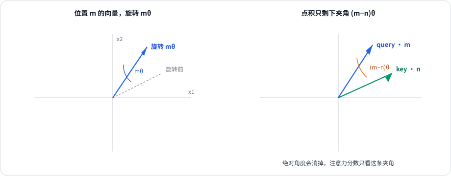

> RoPE 指 **Rotary Position Embedding**（旋转位置编码），由苏剑林等人在 RoFormer 中提出（论文：*RoFormer: Enhanced Transformer with Rotary Position Embedding*，arXiv 2104.09864）。LLaMA、Qwen 以及后来的多数 Decoder-only 模型都用它给注意力加上位置信息。本文的公式按这篇论文的二维旋转写法展开。

## 核心思想

自注意力只看向量之间的点积，**把 token 的顺序打乱，点积一个都不会变**。模型要知道「谁在谁前面」，必须另加位置信息。

RoPE 的做法是：不把位置加到词向量上，而是**按 token 所在的位置，把 query 和 key 各自旋转一个角度**。两个向量都转过之后再做点积，绝对角度会消掉，只留下它们相差多少。于是注意力分数天然是相对位置的函数。



## 背景：注意力为什么没有位置

一个头里的注意力分数是

$$
a_{m,n} = q_m \cdot k_n,\qquad q_m = x_m W_Q,\qquad k_n = x_n W_K
$$

\(x_m\) 是第 \(m\) 个 token 的输入。式子里没有任何 \(m\) 或 \(n\)。把序列倒过来，只要每个 token 的内容还在，分数矩阵只是跟着置换，模型区分不了「猫追狗」和「狗追猫」。

最早的 Transformer 用**绝对位置编码**补上这件事：给第 \(m\) 个位置造一个正弦向量 \(p_m\)，加到词向量上，\(x_m \leftarrow x_m + p_m\)。位置信息进了网络，但加完之后就和内容混在一起，后面每一层的 \(q_m \cdot k_n\) 都不再是「相对距离」的干净函数。模型可以学会利用它，但这个归纳偏置是间接的。

RoPE 换了一个注入位置的地方：**不动词向量，只旋转 Q 和 K**。V 不旋转，因为它负责被加权求和的内容，不负责「在什么位置」。

## 二维情形：旋转为什么只留下相对位置

先看两维，这是整个方法的全部秘密。把一个二维向量逆时针旋转 \(\alpha\) 的矩阵是

$$
R_{\alpha} =
\begin{pmatrix}
\cos\alpha & -\sin\alpha \\
\sin\alpha & \cos\alpha
\end{pmatrix}
$$

它是正交矩阵，\(R_{\alpha}^{\top} = R_{-\alpha}\)，而且 \(R_{\alpha} R_{\beta} = R_{\alpha+\beta}\)。

设位置 \(m\) 的 query、位置 \(n\) 的 key 在旋转之前是 \(q'\)、\(k'\)。RoPE 规定：

$$
q_m = R_{m\theta}\, q',\qquad k_n = R_{n\theta}\, k'
$$

点积对正交变换有一条性质：\( (R a) \cdot (R b) = a \cdot b \)，旋转双方同一个角度不会改变点积。于是可以先把双方一起转回去：

$$
q_m \cdot k_n
= (R_{m\theta}\, q') \cdot (R_{n\theta}\, k')
= q' \cdot \big(R_{m\theta}^{\top} R_{n\theta}\, k'\big)
= q' \cdot \big(R_{(n-m)\theta}\, k'\big)
$$

\(m\theta\) 和 \(n\theta\) 都消失了，矩阵里只剩 \((n-m)\theta\)。**分数只依赖两个 token 相距多远，不依赖它们在句子的绝对位置。** 把整段话往右挪十个字，只要相对距离不变，这一对的注意力分数就不变。

把二维分量写开，就是

$$
q_m \cdot k_n = (q_1 k_1 + q_2 k_2)\cos((m-n)\theta) + (q_1 k_2 - q_2 k_1)\sin((m-n)\theta)
$$

第一项是内容本身的对齐程度，第二项是两个向量「叉」出来的那一部分。两者都乘上相对角度的三角函数，没有单独的 \(m\) 或 \(n\)。

用复数看更短。把 \((q_1, q_2)\) 看成 \(q_1 + i q_2\)，旋转 \(m\theta\) 就是乘 \(e^{i m\theta}\)。点积是这个乘积取实部：

$$
q_m \cdot k_n = \mathrm{Re}\!\left(q'\, e^{i m\theta}\, \overline{k'\, e^{i n\theta}}\right) = \mathrm{Re}\!\left(q'\,\overline{k'}\, e^{i(m-n)\theta}\right)
$$

\(\overline{k' e^{i n\theta}} = \overline{k'} e^{-i n\theta}\)，指数相减，同样只留下 \(m-n\)。

## 高维：两两配对，每对一个频率

真实的 head 维度 \(d\) 是偶数，远大于 2。RoPE 不在整个 \(d\) 维空间里找一个旋转轴，而是**把坐标两两配对**，第 \(i\) 对用自己的角频率 \(\theta_i\)：

$$
\theta_i = 10000^{-2i/d},\qquad i = 0, 1, \ldots, d/2-1
$$

\(d\) 维的旋转矩阵是块对角的，对角线上放着 \(d/2\) 个二维旋转块：

$$
R_m = \mathrm{diag}\big(R_{m\theta_0},\, R_{m\theta_1},\, \ldots,\, R_{m\theta_{d/2-1}}\big)
$$

每一对都满足上一节的推导，所以整个点积仍然只依赖 \(m-n\)。不同对的频率差很多：\(i\) 小的时候 \(\theta_i\) 接近 1，转得快，对近距离敏感；\(i\) 接近 \(d/2\) 时 \(\theta_i\) 很小，转得很慢，相对距离要拉得很长才会转过明显的角度。近处和远处因此落在不同的频率上，而不是共用一个位置编号。

论文还说明了一件设计上的事：相对距离变大时，各对分量的相位逐渐错开，点积里的各项不再同相相加，远距离 token 的分数在幅度上倾向于变小。这是这组频率带来的远程衰减，具体上界在论文里。

## 计算时实际在做什么

实现通常不构造那个 \(d \times d\) 的大矩阵。对第 \(i\) 对分量 \((x_{2i}, x_{2i+1})\)，位置 \(m\) 的旋转就是

$$
\begin{aligned}
x'_{2i}   &= x_{2i}\cos(m\theta_i) - x_{2i+1}\sin(m\theta_i) \\
x'_{2i+1} &= x_{2i}\sin(m\theta_i) + x_{2i+1}\cos(m\theta_i)
\end{aligned}
$$

\(\cos(m\theta_i)\) 和 \(\sin(m\theta_i)\) 只和位置、维度有关，可以按最大长度预先算好。下面是按相邻两维配对的写法：

```python
import torch

def apply_rope(x, cos, sin):
    # x: (..., d)，d 为偶数；cos/sin 已按位置广播到和 x 相同的形状
    d = x.shape[-1]
    x1, x2 = x[..., 0::2], x[..., 1::2]
    y1 = x1 * cos - x2 * sin
    y2 = x1 * sin + x2 * cos
    return torch.stack((y1, y2), dim=-1).reshape(x.shape)
```

LLaMA 一系的实现常把向量切成前后两半再旋转，而不是相邻配对。那只是维度的一种重排，每一对仍然在做一个二维旋转，和上面的公式等价。对照代码时先看它怎么配对，再看公式。

几件和推理直接相关的事：

1. **只旋转 Q 和 K，不旋转 V。** 分数负责位置，V 负责被读出的内容。
2. **旋转可以提前做到 K 上，再写入 KV Cache。** 位置 \(n\) 的旋转只依赖 \(n\) 自己，不依赖后来的 query。缓存里存的是已经转过的 \(k_n\)，之后每个新 query 转一下自己，做的仍是普通点积。注意力 kernel 不用改成「带相对位置偏置」的形式。
3. **Q 和 K 必须用同一套 \(\theta_i\) 和同一种配对。** 两边频率不一致，\(R_m^{\top} R_n\) 就不再是一个只含 \(n-m\) 的旋转，相对位置的性质会坏掉。

## 长度外推时会发生什么

训练时模型只见过长度 \(L\) 以内的旋转角。生成到 \(m > L\) 时，低频那几对的 \(m\theta_i\) 会进入训练中没出现过的角度，注意力的行为就开始偏离。所以 RoPE 本身并不自动具备「训练 4K、直接用到 128K」的能力。

常见的补救都是在**角度**上做文章，而不是重训整个模型：把位置编号按比例压回训练范围（位置插值），或者按频率分别缩放，让高频维持原样、只把低频拉回来（NTK-aware 插值、YaRN）。DeepSeek-V2 用的就是 YaRN，而且只作用在携带 RoPE 的那一段维度上。这些方法解决的是外推，不改变上一节「分数只依赖相对位置」的结论。

## 和 MLA 里解耦 RoPE 的关系

如果 K 是从一个与位置无关的低维向量线性还原出来的，RoPE 会插在还原矩阵和点积之间。相对旋转 \(R_{n-m}\) 每个历史 token 都不一样，还原矩阵就没法提前合并进别的权重。这是 MLA 把内容维度和 RoPE 维度拆开的原因：内容走压缩，位置单独留一小段直接做旋转。推导和缓存上的后果写在 [MLA 多头潜在注意力详解](/p/mla/) 的「为什么要解耦 RoPE」一节。

## 面试常问

**1. 不用位置编码，Transformer 为什么分不清词序？**

注意力分数只有 \(q \cdot k\)。点积与 token 的排列无关，顺序打乱之后，每个 token 看到的分数集合不变。

**2. RoPE 和加在词向量上的正弦位置编码有什么区别？**

正弦位置编码把绝对位置加进输入，位置和内容从第一层就混在一起。RoPE 把位置写成 Q、K 的旋转，点积展开后只出现相对距离 \(m-n\)，这个偏置是算式本身保证的。另外 RoPE 的旋转可以并进 KV Cache，后续注意力仍是普通点积。

**3. 为什么点积只和相对位置有关？**

\(q_m = R_{m\theta} q'\)，\(k_n = R_{n\theta} k'\)。点积变成 \(q' \cdot R_{(n-m)\theta} k'\)，因为 \(R_{m\theta}^{\top} R_{n\theta} = R_{(n-m)\theta}\)。绝对角度被转掉了。

**4. 为什么要很多个频率，而不是所有维度转同一个角度？**

只有一个频率时，距离差一个整周期就会得到相同的角度，远近分不开。\(\theta_i = 10000^{-2i/d}\) 让不同维度的周期差几个数量级，近距离和远距离落在不同的分量上。

**5. V 要不要做 RoPE？**

不做。位置信息已经进入注意力权重，V 是被这些权重读出来的内容。

**6. 缓存里存旋转前的 K 还是旋转后的 K？**

存旋转后的。每个 key 的角度在它被生成时就确定了，不必等 query 到来再转。

## 小结

- 自注意力的点积没有位置，RoPE 用旋转把位置写进 Q 和 K。
- 二维上 \(R_{m\theta}^{\top} R_{n\theta} = R_{(n-m)\theta}\)，绝对位置消掉，分数只剩相对距离。
- 高维是很多个这样的二维旋转，频率按 \(10000^{-2i/d}\) 拉开。
- 只旋转 Q、K；K 转完再进 KV Cache；长度外推要另做角度缩放。
